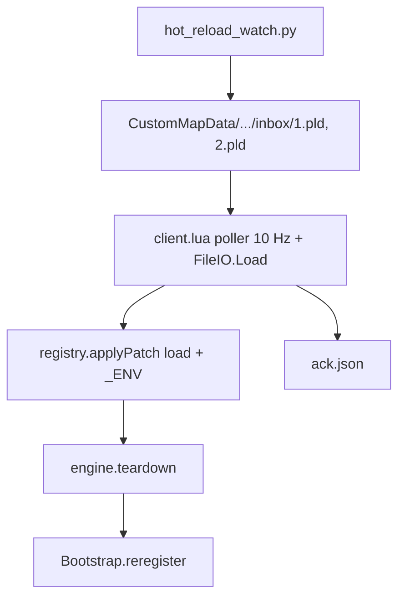

# Hot reload (dev)

Dev hot reload: `go` + `watch`, правки в `src/scenario/**` (и частично `src/utils/logger.lua`, `src/utils/generic.lua`); карта подхватывает через numbered `inbox/N.pld`, пересобирает ability-модуль и перевешивает триггеры без rebuild war3map. Сборка карты — [build/README.md](../build/README.md).

## Архитектура



| Слой | Файлы |
|------|--------|
| Transport | `src/vendor/ext/FileIO.lua`, data-способность `fileioLoad` |
| OS → карта | `tools/hot_reload_watch.py`, `tools/reload_fileio.py` |
| Карта | `src/lib/reload/client.lua` |
| Применение | `src/lib/reload/registry.lua` |
| Teardown | `src/lib/reload/engine.lua` |
| Перерегистрация | `src/lib/triggers/bootstrap.lua` |

## Требования

- `RUN.hotReload = true` в [`src/main.lua`](../src/main.lua) (по умолчанию для dev)
- Data-способность `fileioLoad` в [`src/data/abilities/common.lua`](../src/data/abilities/common.lua) (после bake — в object data карты)
- Allow Local Files = 1 (см. [getting-started.md](getting-started.md))

## Workflow

**Терминал 1** — карта:

```powershell
python build/wc3.py go .
```

Watcher сразу: `python build/wc3.py go . --hot-reload`

**Терминал 2** — watcher:

```powershell
python build/wc3.py watch .
```

Сохраняете `.lua` в `src/scenario/**` или `src/utils/**`. В игре: `[reload] ok seq=N patches=M`.

Inbox: `Documents/Warcraft III/CustomMapData/shadowlands-melee-reload/inbox/1.pld`, `2.pld`, … — **новый файл на каждый reload** (Preloader кэширует один путь).

После `go` через ~1 с: `[reload] FileIO ok` или self-test failed → poller выключен.

Watcher читает `fileioLoad` из `src/data/generated/ids.lua` — перед `watch` нужен bake (`build` / `go`).

Ack (игра): `shadowlands-melee-reload/ack.json` (watcher пока не читает).

## Что перезагружается

| Hot reload | Только `go` (full rebuild) |
|------------|----------------------------|
| `src/scenario/**`, `src/utils/logger.lua`, `src/utils/generic.lua` | `src/data/**`, bake / `generated/` |
| | `src/lib/**`, vendor |
| | новые файлы не в `abilities_registry` |

На reload: снимаются WC3-триггеры и TIMER-триггеры движка, очищаются Damage listeners, заново `registerEvents`. Отложенные `Timed.call` внутри способностей **не** отменяются.

## Known limitations (v1)

- [`scenario/common/control.lua`](../src/scenario/common/control.lua) — per-unit триггеры не трекаются engine
- `require`-кэш war3map не сбрасывается; module-level state в ability обнуляется при reload
- Изменения реестра способностей (`tools/bake.lua`) — `wc3 go`

## Troubleshooting

| Симптом | Проверить |
|---------|-----------|
| Нет `[reload] ok` после save | Запущен `watch`? Файл в `abilities_registry`? |
| `FileIO self-test failed` / `poller off` | `fileioLoad` в object data, Allow Local Files, `-allowLocalFiles` в `wc3.py go` |
| Save есть, reload нет | Старый `seq` (dedup); в логе путь `inbox.txt` — пересобрать карту (`go`) |
| Карта кидает в меню | `.w3x` &lt; ~7050 KiB или legacy `__HOT_RELOAD__` в корне war3map — см. [build/README.md](../build/README.md) |
| `not in abilities_registry` | `bake` + `go` |

## Ручная проверка

1. Cold start: cast + damage — OK
2. Правка ability → save → `[reload] ok`, поведение меняется
3. Два reload подряд — нет двойного урона / cast
4. Правка `utils/logger.lua` / `utils/generic.lua` — `_G.dump` / `_G.Generic`
5. Правка `src/data/*` — только `wc3 go`
